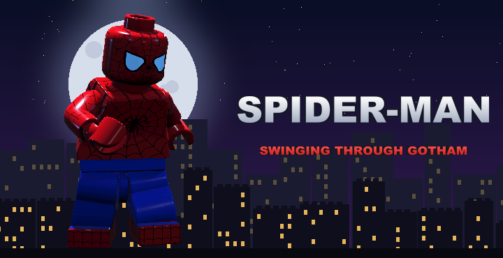
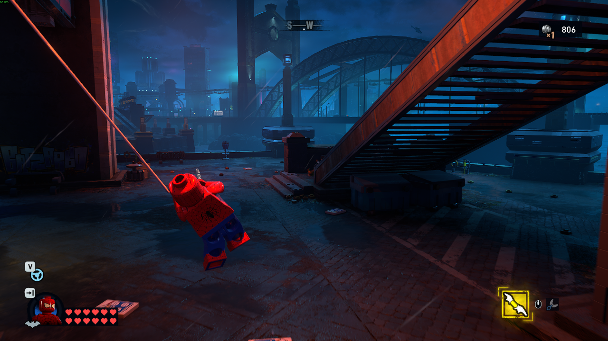
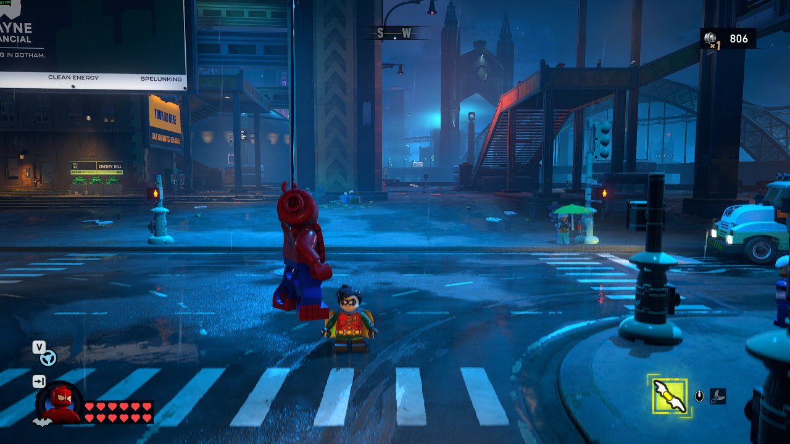
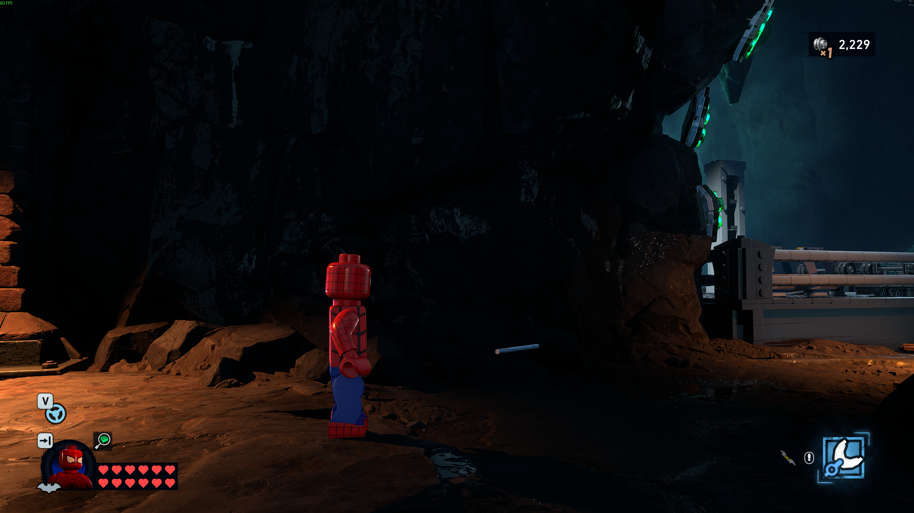

# SpideyGotham — Spidey in LEGO Gotham

Spider-Man swings through LEGO Gotham. One button turns LEGO Batman into LEGO Spider-Man (red-and-blue suit, white lenses, the works), with web-swinging, a web launch and web shots that fight enemies and smash breakables. Press it again and you are Batman, in whatever suit you had on.

A Marvel's Spider-Man Remastered × LEGO Batman: Legacy of the Dark Knight mashup for PC.

> [!IMPORTANT]
> **Batman must be unlocked first.** Spider-Man only works once Batman is unlocked and playable. It will not work as young Bruce Wayne or as Bruce Wayne in the early training sections.

**Easiest install:** one click on Melty: https://melty.gg/m/spideygotham  
**Manual install:** download `SpideyGotham-1.0.1.zip` from the [Releases](../../releases) page and follow *Install* below.

**More from me:** [YouTube @Pixelplayz2215](https://www.youtube.com/@Pixelplayz2215)

| Web swing | Web launch | Web shot |
|---|---|---|
|  |  |  |

## Features

- **Spider-Man suit on Batman.** Works from any of Batman's suits: Spidey always looks the same, and switching back restores the suit you were wearing. Instant switch, HUD portrait included.
- **Web swing.** Hold to shoot a web at the nearest building ahead and swing from it, Spider-Man-game style: momentum carries you forward, you hang from the web by the hand on the anchor's side, and letting go flings you on.
- **Web launch.** From the ground, a web straight up launches you 2.5× higher than a normal jump, so you can start swinging from the street.
- **Web shots.** Fast white web bolts in the direction Spidey faces. They snap to nearby enemies (hit reaction and damage, about 4 shots for a basic goon) and break breakable objects just like Batman's batarangs.
- **White, softly glowing webs** that stay visible in Gotham's dark streets.
- **Spider-Man Remastered sound** (optional, from your own copy of that game): web-shooter sounds, Spidey's voice lines and the traversal music while swinging.
- **Spidey everywhere:** main menu figure, menu logo, HUD portrait and the startup splash box.
- Other characters (Jim Gordon etc.) are not affected; Spidey belongs to Batman only.

## Controls

| Action | Keyboard / mouse | PlayStation 5 controller |
|---|---|---|
| Spider-Man on / off | **F6** | **L3 + R3** (press both sticks) |
| Web swing | hold **Q** (or Mouse 4) | hold **R2** |
| Web launch | **R** (or Mouse 5) | **R1** |
| Web shot | **Right mouse button** | **L2** |

Everything else (moving, jumping, attacking, camera) uses the game's normal controls. While Spidey is on, Batman's gadgets, grapple and glide are switched off so they don't fire alongside the web moves; they come back when you switch to Batman.

## Requirements

- **LEGO Batman: Legacy of the Dark Knight** on PC (Steam), Windows 10/11.
- Optional: **Marvel's Spider-Man Remastered** installed on the same PC, for the Spider-Man sounds and music. Without it, everything works, just with no Spider-Man audio.
- Single-player / offline only.
- **Batman must be unlocked and playable.** Spider-Man only works when you are playing as Batman. It does not work as young Bruce Wayne or as Bruce Wayne in the early training sections; play on until Batman is unlocked, then press F6 / L3 + R3.

## Install (manual)

1. Open the game's folder: in Steam, right-click LEGO Batman: Legacy of the Dark Knight → Manage → Browse local files.
2. Go to `LEGOBatmanLotDK\Binaries\Win64`.
3. Copy everything **inside** this package's `Win64` folder into that folder (`dwmapi.dll`, the three Microsoft runtime files `msvcp140.dll`, `vcruntime140.dll`, `vcruntime140_1.dll`, and the `ue4ss` folder). Allow it to replace files if asked.
4. Start the game. The main menu should now show LEGO Spider-Man. In game, press **F6** (or **L3 + R3**) while playing as Batman.

**Already using UE4SS?** Copy only `Win64\ue4ss\Mods\SpideyGotham` into your `ue4ss\Mods` folder and add the line `SpideyGotham : 1` to `ue4ss\Mods\mods.txt`.

### Spider-Man sounds (optional)

The mod finds Marvel's Spider-Man Remastered automatically when it's launched through Melty. Otherwise, tell it where the game is once:

1. Open `%LOCALAPPDATA%\SpideyGotham` (paste that into the Explorer address bar; the folder appears after the first start with the mod).
2. Create a text file named `spiderman_dir.txt` containing the Spider-Man Remastered install folder, for example
   `D:\SteamLibrary\steamapps\common\Marvel's Spider-Man Remastered`
3. Restart LEGO Batman. The first start builds a small sound cache, so the sounds may take a moment the first time.

No Spider-Man game files are included in this mod; sounds are read from your own installation.

## Uninstall

1. In `LEGOBatmanLotDK\Binaries\Win64`, delete `dwmapi.dll`, `msvcp140.dll`, `vcruntime140.dll`, `vcruntime140_1.dll` and the `ue4ss` folder (or, if you use other UE4SS mods, just `ue4ss\Mods\SpideyGotham` and its line in `mods.txt`).
2. Startup splash: in `LEGOBatmanLotDK\Content\Splash`, delete `Splash.bmp` and rename `Splash_Batman_original.bmp` back to `Splash.bmp`. (Steam → Verify integrity of game files also restores it.)
3. Optional: delete `%LOCALAPPDATA%\SpideyGotham` (the mod's cache and settings).

The mod never edits your save files. If you quit while Spider-Man is on, your own Batman suit is put back the next time you load in.

## Notes

- Turning Spider-Man on briefly switches Batman to his original suit underneath (so every suit's armour, capes and collars fit the Spidey look); switching off puts your chosen suit back.
- The startup splash is drawn from your in-game Spidey once you have played with the mod, and shows from the next game start (the original is backed up next to it, see Uninstall).
- If something looks wrong, `ue4ss\UE4SS.log` and `%LOCALAPPDATA%\SpideyGotham\SpideyLink.log` show what the mod is doing.

## Building from source

| Folder | What it is |
|---|---|
| `mod/ue4ss/Mods/SpideyGotham/` | The UE4SS Lua mod (`Scripts/main.lua`, `Scripts/spidey.lua`, generated `Scripts/config.lua`) and its textures |
| `design/` | Tuning sheets (JSON). `config.lua` and `src/SpideyLink/Generated.cs` are generated from them |
| `tools/Sheets/` | The sheet generator: `dotnet run --project tools/Sheets -c Release -- generate <repo folder>` |
| `src/SpideyLink/` | SpideyLink.exe (.NET 10): reads Spider-Man Remastered's sounds from your own install and plays the audio cues |
| `tools/*.py` | Pillow scripts that drew the suit prints, menu logo and splash background |
| `art/`, `screenshots/` | Source art and store screenshots |

Build SpideyLink with `dotnet publish src/SpideyLink -c Release -r win-x64 --self-contained -p:PublishSingleFile=true` and put it in `Mods/SpideyGotham/bin/`, together with [vgmstream-cli](https://github.com/vgmstream/vgmstream) in `bin/vgmstream/`. UE4SS itself comes from [RE-UE4SS](https://github.com/UE4SS-RE/RE-UE4SS). The ready-made zip on the Releases page already contains all of this.

## License

The mod's own code and art are released under [CC BY 4.0](LICENSE). UE4SS, vgmstream and the Microsoft runtime files keep their own licenses. No game files are included in this repository or its releases.

## Credits

- Mod, Spider-Man suit prints, webs, menu logo and splash art: original work for this mod, made with AI assistance (Claude by Anthropic) and tested in game.
- [UE4SS](https://github.com/UE4SS-RE/RE-UE4SS) (MIT license, included with its LICENSE) loads the mod.
- [vgmstream](https://github.com/vgmstream/vgmstream) (license in `bin\vgmstream\COPYING`) decodes the Spider-Man audio from your own install.
- Microsoft Visual C++ runtime files (`msvcp140.dll`, `vcruntime140.dll`, `vcruntime140_1.dll`), included as redistributable files so the mod loader starts on PCs without the runtime installed.

Fan-made and not affiliated with or endorsed by Marvel, Sony Interactive Entertainment, Insomniac Games, Warner Bros. Games, TT Games, DC or the LEGO Group. All trademarks belong to their owners.
